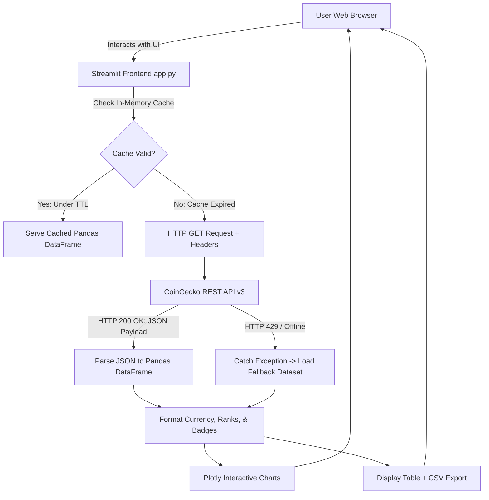

# 🪙 CryptoPulse: Real-Time Cryptocurrency Price Tracker & Analytics Dashboard

[](https://streamlit.io/)
[](https://www.python.org/downloads/)
[](https://www.coingecko.com/en/api)
[](https://opensource.org/licenses/MIT)

A modern, production-grade **Cryptocurrency Market Intelligence Dashboard** built with **Python**, **Streamlit**, **Requests**, **Pandas**, and **Plotly**. This project demonstrates end-to-end data acquisition from third-party REST APIs, defensive error handling, client-side caching to respect free-tier rate limits, interactive financial visualizations, and clean software architecture suitable for a data science and software engineering portfolio.

---

## 📑 Table of Contents

- [Overview & Portfolio Value](#-overview--portfolio-value)
- [Key Features](#-key-features)
- [System Architecture & Data Flow](#-system-architecture--data-flow)
- [Supported Cryptocurrencies & Currencies](#-supported-cryptocurrencies--currencies)
- [Beginner-Friendly Concept Explanations](#-beginner-friendly-concept-explanations)
  - [1. REST APIs and HTTP GET Requests](#1-rest-apis-and-http-get-requests)
  - [2. Query Parameters vs. HTTP Headers](#2-query-parameters-vs-http-headers)
  - [3. JSON to Pandas DataFrame Conversion](#3-json-to-pandas-dataframe-conversion)
  - [4. Streamlit Caching and Python Decorators](#4-streamlit-caching-and-python-decorators)
  - [5. Exception Handling & Rate Limits (HTTP 429)](#5-exception-handling--rate-limits-http-429)
  - [6. Plotly Interactive Visualizations](#6-plotly-interactive-visualizations)
- [Project Structure](#-project-structure)
- [Local Installation & Setup (Windows PowerShell)](#-local-installation--setup-windows-powershell)
- [Configuring the CoinGecko API Key](#-configuring-the-coingecko-api-key)
- [Troubleshooting Common Issues](#-troubleshooting-common-issues)
- [Uploading to GitHub](#-uploading-to-github)
- [Free Deployment on Streamlit Community Cloud](#-free-deployment-on-streamlit-community-cloud)
- [Screenshots](#-screenshots)
- [Future Roadmap](#-future-roadmap)
- [Attribution & Acknowledgments](#-attribution--acknowledgments)

---

## 🌟 Overview & Portfolio Value

In modern data engineering and financial analytics, consuming live public APIs reliably while operating under free-tier constraints (rate limits, network latency, ephemeral cloud containers) is a critical core skill. 

This project goes far beyond a naive tutorial script by implementing:
1. **Defensive API Ingestion:** Gracefully handles network timeouts, missing fields, connection drops, and HTTP 429 throttling.
2. **Deterministic Fallback Simulation:** Automatically switches to an offline fallback dataset if the public API quota is momentarily exhausted, ensuring recruiters and evaluators can always interact with the UI.
3. **Optimized Client Caching:** Uses Streamlit's `@st.cache_data` with Time-To-Live (TTL) expiration to balance data freshness against API call quotas.
4. **Interactive Financial Visualizations:** Leverages Plotly charts with custom hover templates, color-coded price action, and responsive layouts.
5. **Zero Hardcoded Secrets:** Strict separation of configuration and secrets using Streamlit Secrets and environment variables.

---

## ✨ Key Features

- **Multi-Currency Support:** Switch instantaneously between **USD ($)** and **INR (₹)** with automatic metric formatting.
- **7 Core Cryptocurrencies Included:** Pre-configured for **Bitcoin (BTC)**, **Ethereum (ETH)**, **Solana (SOL)**, **BNB (BNB)**, **XRP (XRP)**, **Dogecoin (DOGE)**, and **Cardano (ADA)**, with multi-select support for additional tokens.
- **Executive Metric Cards (KPIs):** Real-time cards displaying BTC price, ETH price, top 24-hour market gainer, and total tracked market capitalization.
- **Search & Multi-Criteria Sorting:** Instant text-filtering across coin names and ticker symbols, plus 6 sorting modes (Market Cap Rank, Price, 24h Change %, Volume).
- **Interactive Plotly Visualizations:**
  - Horizontal bar chart of Market Capitalization.
  - Diverging color bar chart of 24h Percentage Change (green for gains, red for losses).
  - Bubble scatter chart comparing 24h Trading Volume vs. Market Cap.
- **Historical Price Trends:** Interactive line chart with area fill for **1 Day (24 hours)**, **7 Days**, and **30 Days** historical horizons.
- **CSV Data Export:** One-click download button exporting filtered and sorted market snapshots with timestamps.
- **Free-Tier Optimized:** Built specifically for CoinGecko's Demo / Public tier without requiring paid subscriptions.
- **Attribution Included:** Direct attribution and links to CoinGecko's official API documentation.

---

## 🏗 System Architecture & Data Flow



---

## 🪙 Supported Cryptocurrencies & Currencies

### Preconfigured Cryptocurrencies
| Asset Name | Ticker Symbol | CoinGecko API ID | Category |
| :--- | :--- | :--- | :--- |
| **Bitcoin** | BTC | `bitcoin` | Layer 1 / Store of Value |
| **Ethereum** | ETH | `ethereum` | Layer 1 Smart Contracts |
| **Solana** | SOL | `solana` | High-Throughput Layer 1 |
| **BNB** | BNB | `binancecoin` | Exchange Ecosystem / L1 |
| **XRP** | XRP | `ripple` | Cross-Border Payments |
| **Dogecoin** | DOGE | `dogecoin` | Decentralized Meme / PoW |
| **Cardano** | ADA | `cardano` | Proof-of-Stake Smart Contracts |

*(Users can also add Avalanche, Polkadot, Chainlink, Shiba Inu, and Polygon from the sidebar multi-select).*

### Base Currencies
- **USD ($)** — United States Dollar (Global standard benchmark)
- **INR (₹)** — Indian Rupee (Formatted with Indian numerical representation)

---

## 🎓 Beginner-Friendly Concept Explanations

### 1. REST APIs and HTTP GET Requests
- **What is a REST API?** A *Representational State Transfer Application Programming Interface* allows two computer programs to communicate over the web using standard internet protocols. In this project, CoinGecko acts as the **server** holding millions of crypto data points, and our Python script acts as the **client** requesting a small slice of that data.
- **HTTP GET Method:** An HTTP `GET` request is used strictly to *retrieve* data from a server without modifying anything on the server.
- **Status Codes:**
  - `200 OK`: Request succeeded; JSON payload returned.
  - `400 Bad Request`: Invalid parameters supplied.
  - `429 Too Many Requests`: Client exceeded the allowed rate limit quota.
  - `500 Internal Server Error`: An issue occurred on CoinGecko's servers.

### 2. Query Parameters vs. HTTP Headers
When making an HTTP call using Python's `requests` library:
- **Query Parameters (`params={...}`):** Key-value pairs appended directly to the URL after a `?` character. For example:
  ```text
  https://api.coingecko.com/api/v3/coins/markets?vs_currency=usd&ids=bitcoin,ethereum
  ```
  Here, `vs_currency=usd` tells the server to calculate prices in US Dollars, and `ids=bitcoin,ethereum` specifies which coins to return.
- **HTTP Headers (`headers={...}`):** Metadata sent alongside the request behind the scenes. In our project:
  ```python
  headers = {
      "Accept": "application/json",
      "x-cg-demo-api-key": api_key  # Informs CoinGecko of our authorized key
  }
  ```

### 3. JSON to Pandas DataFrame Conversion
CoinGecko returns data formatted as **JSON** (*JavaScript Object Notation*), which Python receives as a list of dictionaries:
```json
[
  {"id": "bitcoin", "current_price": 95200.0, "market_cap": 1880000000000},
  {"id": "ethereum", "current_price": 2740.0, "market_cap": 330000000000}
]
```
Passing this list directly into `pd.DataFrame(raw_data)` instantly constructs a 2-dimensional tabular DataFrame with named columns and rows, unlocking vectorized filtering, sorting, and statistical transformations in nanoseconds.

### 4. Streamlit Caching and Python Decorators
- **How Streamlit Works:** By default, Streamlit re-executes the *entire* Python script from top to bottom every single time a user clicks a button, changes a dropdown, or types in a text box.
- **The Problem:** If a user clicks three filters in 10 seconds, making 3 live HTTP requests to CoinGecko would quickly trigger an HTTP 429 Rate Limit ban on free accounts.
- **The Solution (`@st.cache_data`):**
  ```python
  @st.cache_data(ttl=120, show_spinner=False)
  def fetch_market_data(coin_ids, vs_currency, api_key):
      # ... fetch from CoinGecko ...
  ```
  A **decorator** is a Python function that wraps another function to modify its behavior without changing its code. `@st.cache_data` tells Streamlit:
  *"If this function is called with the exact same arguments (`coin_ids`, `vs_currency`), return the cached DataFrame in memory instead of sending a new web request, until the TTL (Time-To-Live) of 120 seconds has elapsed."*

### 5. Exception Handling & Rate Limits (HTTP 429)
Network requests can fail for dozens of reasons: WiFi drops, DNS errors, server outages, or rate-limiting. Instead of letting the application crash with an unhandled traceback, we wrap network calls in `try...except` blocks:
```python
try:
    response = requests.get(endpoint, params=params, headers=headers, timeout=12)
    if response.status_code == 429:
        return None, "Rate limit reached. Please wait 60s or enter a Demo key."
    response.raise_for_status()
except requests.exceptions.Timeout:
    return None, "Request timed out after 12s."
except requests.exceptions.ConnectionError:
    return None, "Network disconnected."
```
If an error occurs, the function returns a helpful message and our app falls back cleanly to an offline dataset.

### 6. Plotly Interactive Visualizations
Unlike static chart libraries (such as Matplotlib), **Plotly** outputs HTML/JavaScript charts directly inside Streamlit:
- Users can hover their cursor over data points to inspect precise values and dates.
- Users can zoom in on specific date ranges, pan across time axes, and toggle individual series on or off in the legend.
- Charts render with smooth dark-mode styling matching the application aesthetics.

---

## 📁 Project Structure

```text
CryptoPulse/
├── .streamlit/
│   ├── secrets.toml          # Local secret keys (ignored by git)
│   └── secrets.toml.example  # Public template for secrets configuration
├── screenshots/
│   └── README.md             # Instructions for capturing and storing screenshots
├── .gitignore                # Git rules excluding venv, cache, and secrets
├── app.py                    # Complete Streamlit dashboard application
├── requirements.txt          # Python package dependencies with versions
└── README.md                 # Complete documentation and portfolio guide
```

---

## 💻 Local Installation & Setup (Windows PowerShell)

Follow these step-by-step PowerShell commands to set up and run the application on Windows:

### Step 1: Open PowerShell and Navigate to the Project Folder
```powershell
cd e:\Desktop\Python_Api
```

### Step 2: Create a Dedicated Python Virtual Environment
Creating a virtual environment ensures project dependencies do not conflict with other Python projects on your machine:
```powershell
python -m venv venv
```

### Step 3: Activate the Virtual Environment
```powershell
.\venv\Scripts\Activate.ps1
```
> **Tip:** If PowerShell displays an `Execution_Policies` restriction error, run:
> ```powershell
> Set-ExecutionPolicy -ExecutionPolicy RemoteSigned -Scope CurrentUser
> ```
> Then re-run `.\venv\Scripts\Activate.ps1`. When activated, your prompt will display `(venv)`.

### Step 4: Upgrade Pip and Install Dependencies
```powershell
python -m pip install --upgrade pip
pip install -r requirements.txt
```

### Step 5: Run the Streamlit Application Locally
```powershell
streamlit run app.py
```
> **Windows Tip:** If PowerShell returns `'streamlit' is not recognized as an internal or external command`, run:
> ```powershell
> python -m streamlit run app.py
> ```

Streamlit will launch local web servers and output URLs:
```text
  Local URL: http://localhost:8501
  Network URL: http://192.168.x.x:8501
```
Open `http://localhost:8501` in your browser to view your live dashboard!

---

## 🔑 Configuring the CoinGecko API Key

The application works out of the box using CoinGecko's public endpoints. However, obtaining a **free CoinGecko Demo API Key** raises your quota to ~30 requests/minute and prevents throttling.

### Option A: Using Streamlit Secrets (Recommended for Streamlit)
1. In the `.streamlit/` directory, create or edit `secrets.toml`:
   ```toml
   COINGECKO_API_KEY = "CG-yourActualKeyHere"
   ```
2. Streamlit automatically detects this key without needing to restart your terminal.
3. Because `.streamlit/secrets.toml` is listed in `.gitignore`, your secret key will **never** be leaked or pushed to GitHub!

### Option B: Using PowerShell Environment Variables
In your PowerShell terminal before running the app:
```powershell
$env:COINGECKO_API_KEY = "CG-yourActualKeyHere"
streamlit run app.py
```

### Option C: Enter Directly in the App Sidebar
If you run the app without pre-configured secrets, click **"Add Free Demo API Key"** in the sidebar expander and paste your key into the password field.

---

## 🛠 Troubleshooting Common Issues

| Issue / Error | Likely Cause | Solution |
| :--- | :--- | :--- |
| **`'streamlit' is not recognized` in PowerShell** | The Python scripts directory is not added to system PATH. | Run `python -m streamlit run app.py` instead of `streamlit run app.py`. |
| **`Execution_Policies` script error in PowerShell** | Windows security restricts executing unsigned scripts. | Run: `Set-ExecutionPolicy -ExecutionPolicy RemoteSigned -Scope CurrentUser` and re-activate `venv`. |
| **`HTTP 429: Too Many Requests`** | CoinGecko free rate limit reached due to rapid page refreshes. | Wait 60 seconds. The app will automatically show the offline demo dataset in the meantime. Consider adding a free Demo key. |
| **`ModuleNotFoundError: No module named 'streamlit'`** | The virtual environment was not activated before running `pip install` or `streamlit run`. | Make sure `(venv)` appears in your PowerShell prompt, then run `pip install -r requirements.txt`. |
| **`Port 8501 is already in use`** | Another instance of Streamlit is already running. | Run on a different port: `streamlit run app.py --server.port 8502`. |
| **CoinGecko connection timeout** | Slow network or firewall blocking external API calls. | Check your internet connection. The app has a built-in 12-second timeout and offline fallback. |

---

## 🚀 Uploading to GitHub

Follow these commands to push your project to a new GitHub repository:

### Step 1: Initialize Git and Verify `.gitignore`
Make sure secrets and virtual environments are excluded:
```powershell
git init
git status
```
*(Ensure `venv/` and `.streamlit/secrets.toml` are NOT listed under untracked files).*

### Step 2: Stage and Commit the Files
```powershell
git add .
git commit -m "feat: complete cryptocurrency market tracker with Streamlit and CoinGecko API"
```

### Step 3: Link Your GitHub Repository and Push
1. Create a new repository on [GitHub](https://github.com/new) named `crypto-price-tracker`.
2. Link your local repository and push:
```powershell
git branch -M main
git remote add origin https://github.com/<YOUR_GITHUB_USERNAME>/crypto-price-tracker.git
git push -u origin main
```

---

## ☁️ Free Deployment on Streamlit Community Cloud

Streamlit Community Cloud lets you deploy and host this dashboard online for free with 1 click:

1. Visit [share.streamlit.io](https://share.streamlit.io/) and sign in using your GitHub account.
2. Click **"New app"**.
3. Select your repository: `<YOUR_GITHUB_USERNAME>/crypto-price-tracker`.
4. Set the **Main file path** to `app.py`.
5. Click **"Advanced settings..."** to add your secrets:
   ```toml
   COINGECKO_API_KEY = "CG-yourApiKeyHere"
   ```
6. Click **"Deploy!"**.
Your dashboard will build in under 2 minutes and provide a shareable public URL (e.g., `https://your-app-name.streamlit.app/`) to add to your resume and LinkedIn!

---

## 📸 Screenshots

To populate this section in your portfolio repository:
1. Capture screenshots of your running app (see [`screenshots/README.md`](screenshots/README.md)).
2. Save them into the `screenshots/` directory.
3. Un-comment the markdown image links below:

```markdown
<!--


-->
```

---

## 🔮 Future Roadmap

Enhancements planned for future iterations:
- [ ] **Personal Watchlist / Favorites:** Persist favorite coins across sessions using `st.session_state`.
- [ ] **Price Threshold Alerts:** Integrate desktop or Telegram/Discord webhook notifications when an asset crosses a target price.
- [ ] **Database Persistence (SQLite / PostgreSQL):** Periodically log snapshots to a relational database to build multi-year custom historical datasets.
- [ ] **Technical Indicators:** Calculate Simple Moving Averages (SMA-20, SMA-50) and Relative Strength Index (RSI) using Pandas.
- [ ] **Portfolio Tracker / Profit & Loss (P&L):** Allow users to input their token holdings and purchase prices to calculate net asset value and unrealized gains.

---

## 🦎 Attribution & Acknowledgments

- Market data generously provided by [CoinGecko REST API](https://www.coingecko.com/en/api).
- Dashboard framework provided by [Streamlit](https://streamlit.io/).
- Visualization engine powered by [Plotly Technologies Inc.](https://plotly.com/).
- Built with ❤️ for Data Science & Financial Engineering Portfolios.
